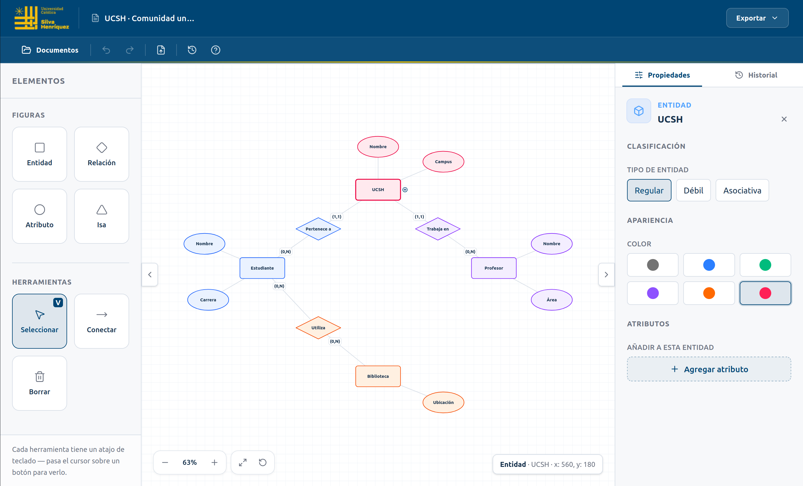

# MER Designer ✨

Un editor web para crear diagramas **Entidad–Relación (MER)** con la notación de Peter Chen y transformarlos en un modelo lógico.



## Estado del proyecto

El proyecto está en desarrollo activo hacia una v1 pública. La aplicación ya permite crear y editar diagramas conceptuales, guardar proyectos localmente, importar/exportar JSON, exportar imágenes y trabajar con una vista de modelo lógico.

Consulta los [issues abiertos](https://github.com/open-ucsh/web-modelador-bd/issues) para conocer el trabajo planificado.

## 🎓 ¿Para qué sirve?

Creado para estudiantes de **Fundamentos a las Bases de Datos**.

Diseña entidades, relaciones y atributos antes de pasar a tablas, claves foráneas o SQL. Ideal para ejercicios, tareas y evaluaciones.

## 🚀 Cómo usarlo

1. Crea las entidades de tu problema.
2. Añade atributos y relaciones.
3. Conecta y organiza el modelo en el canvas.
4. Guarda o exporta tu diagrama.

> Primero entiende los datos. Después construye la base de datos.

## Desarrollo local

Requisitos: Node.js 20 o superior y pnpm 11.

```bash
git clone https://github.com/open-ucsh/web-modelador-bd.git
cd web-modelador-bd
pnpm install
pnpm dev
```

Abre [http://localhost:3000](http://localhost:3000). Los comandos de calidad disponibles son:

```bash
pnpm typecheck
pnpm lint
pnpm format:check
pnpm build
```

La guía completa para desarrollar está en [`docs/development.md`](./docs/development.md).

## Contribuir

Las contribuciones son bienvenidas: código, documentación, ejercicios, reportes de errores y propuestas de mejora. Antes de abrir un pull request, revisa [`CONTRIBUTING.md`](./CONTRIBUTING.md), el [código de conducta](./CODE_OF_CONDUCT.md) y los [issues existentes](https://github.com/open-ucsh/web-modelador-bd/issues).

Para vulnerabilidades de seguridad, no abras un issue público: sigue [`SECURITY.md`](./SECURITY.md).

## Documentación

- [Guía de uso](./docs/usage.md)
- [Notación ER](./docs/er-notation.md)
- [Guía de desarrollo](./docs/development.md)
- [Arquitectura](./docs/architecture.md)
- [Ejercicios prácticos](./docs/practice/README.md)

## Licencia

Distribuido bajo la [licencia MIT](./LICENSE).


